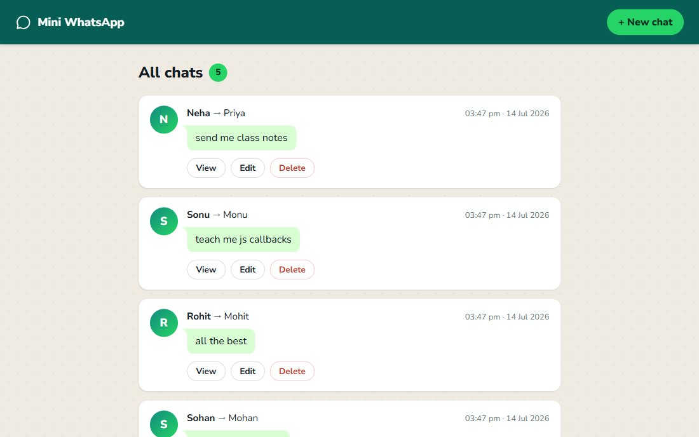

# Mini WhatsApp

Send, edit and delete chat messages, with schema validation and an error-handling middleware.



## Tech stack

Node.js · Express 5 · MongoDB with Mongoose · EJS · method-override

## Run it locally

You need [Node.js](https://nodejs.org) 20 or newer and [MongoDB Community Server](https://www.mongodb.com/try/download/community) running on the default port (27017).

```bash
npm install
node init.js    # adds a few sample chats; press Ctrl+C once they're printed
node index.js
```

Then open http://localhost:8080/chats.
